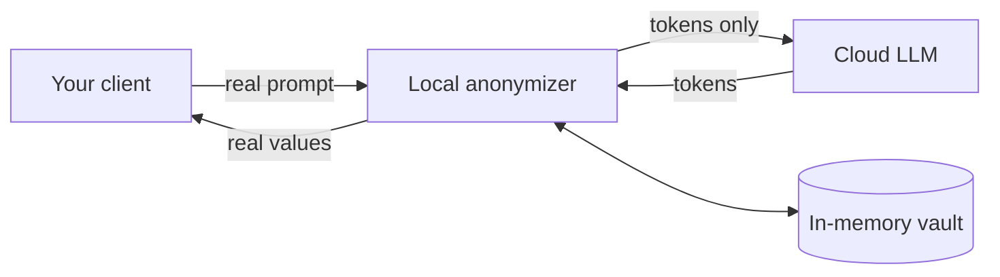
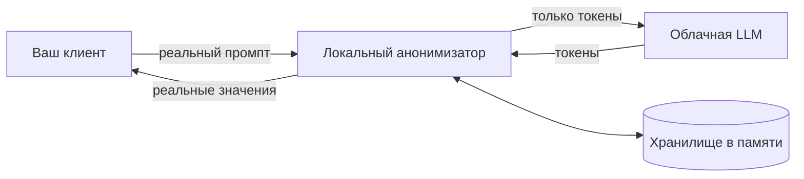

<a id="english"></a>

<p align="center">
  
</p>

<h1 align="center">Universal LLM Prompt Anonymizer</h1>

<p align="center">
  <b>Keep personal data out of cloud prompts.</b><br>
  A local proxy and OpenCode plugin that replaces names, emails, phones and other PII with stable tokens, then restores the real values in the response.
</p>

<p align="center">
  <a href="LICENSE"></a>
  
  
  
</p>

<p align="center">
  <a href="#english">English</a> ·
  <a href="#русский">Русский</a> ·
  <a href="README.ru.md">Русский README</a> ·
  <a href="INSTALL.md">Install guide</a> ·
  <a href="INSTALL.ru.md">Инструкция</a>
</p>

```
You:      My name is Sarah Connor, email sarah@example.com.
Cloud:    My name is [[PERSON_a812_1]], email [[EMAIL_a812_1]].
You see:  My name is Sarah Connor, email sarah@example.com.
```

## Quick start

### Desktop app

Download the installer from [Releases](https://github.com/Closegamer/universal-llm-prompt-anonymizer/releases/latest):

| OS | File |
| --- | --- |
| Windows x64 | `universal-llm-prompt-anonymizer-*-win-x64.exe` |
| macOS Apple Silicon | `universal-llm-prompt-anonymizer-*-mac-arm64.dmg` |
| Linux x64 | `.AppImage` or `.deb` |

The app starts the proxy, lives in the tray, and turns every detector into a checkbox. If you want dates to pass through unchanged, uncheck **Dates of birth**. Start at login is another checkbox. The settings apply to every client that uses the same proxy.

The installers are not code signed yet. On Windows, choose **More info** then **Run anyway** if SmartScreen appears. On macOS, right-click the app and choose **Open**.

### OpenCode

```bash
npm install -g github:Closegamer/universal-llm-prompt-anonymizer
prompt-anonymizer install
```

Start a new OpenCode session. The plugin starts the proxy and routes supported providers through it. Local providers such as Ollama are left alone.

### Any other client

```bash
npm install -g github:Closegamer/universal-llm-prompt-anonymizer
prompt-anonymizer
```

Keep it running, then point the client at the matching prefix. Stop it later with `prompt-anonymizer stop`.

| Provider | Base URL |
| --- | --- |
| OpenAI | `http://127.0.0.1:8787/openai/v1` |
| Anthropic | `http://127.0.0.1:8787/anthropic` |
| DeepSeek | `http://127.0.0.1:8787/deepseek/v1` |
| Google Gemini | `http://127.0.0.1:8787/gemini` |
| OpenRouter | `http://127.0.0.1:8787/openrouter/v1` |
| Groq | `http://127.0.0.1:8787/groq/openai/v1` |
| Mistral | `http://127.0.0.1:8787/mistral/v1` |
| xAI | `http://127.0.0.1:8787/xai/v1` |

Claude Code example:

```bash
ANTHROPIC_BASE_URL=http://127.0.0.1:8787/anthropic claude
```

The client keeps using its own API key. The proxy forwards authentication headers and never stores them.

Full cross-platform guide for Windows, macOS and Linux: [INSTALL.md](INSTALL.md).

## Why

Cloud LLM providers receive everything you send them: names, emails, phones, dates of birth, account numbers, file paths and tool output. This proxy keeps that data local. The model still does the work, but it sees placeholders instead of real values.

The token map lives only in the proxy's memory on your machine. It is not written to disk and is not sent to the provider.

## Features

- Local NER for names and surnames in English and Russian.
- Structured detection for emails, phones, cards, IBANs, SSNs, IP addresses, dates, nicknames, IDs and addresses.
- OS username and home path detection, including `C:\Users\name`, `/home/name` and `/Users/name`.
- Streaming-safe restoration, including tokens split across SSE events and tool call arguments.
- Works with any OpenAI-compatible or Anthropic-compatible client.
- Desktop tray app with per-category checkboxes and start at login.
- OpenCode plugin with automatic proxy startup and provider rewiring.
- No PII at rest. The vault is memory only.
- Bilingual documentation: English and Russian.

## Desktop app

The desktop build runs the same local proxy and stays in the system tray. Open the settings window from the tray and choose exactly what should be hidden.

- **What to hide:** names, nicknames, dates of birth, usernames, emails, phones, addresses, cards, IBANs, SSNs, account IDs, long numbers and IP addresses.
- **Behavior:** start at login, preload the name models, write a request log, allow unscanned non-JSON bodies.
- **Advanced:** proxy port.

Changes restart the proxy. The OpenCode plugin reuses the running proxy, so the desktop settings also apply to OpenCode.

The app stores its settings in the Electron user data directory and the proxy log next to them. Use **Open log** in the app to inspect startup errors.

## How it works



1. The proxy parses the outgoing JSON request and walks every string value: system prompt, message history, tool inputs, tool outputs and attached text.
2. Detectors replace PII with tokens and store the real values in an in-memory vault.
3. A system instruction tells the model that tokens are opaque and must not be changed.
4. The upstream response is restored before it reaches the client, including streamed SSE events and tool call arguments.
5. Tokens split across stream chunks are buffered and restored correctly.
6. Local providers are skipped by default.

## What gets replaced

| Category | Examples |
| --- | --- |
| Contact data | Emails, phones in international, US and Russian formats |
| Financial data | Payment cards with Luhn validation, IBANs with mod 97 validation |
| Government IDs | US SSNs, labeled passport and account numbers |
| Network data | IP addresses |
| Dates | Dates near birth labels such as `born`, `DOB`, `date of birth`, `родился`, `дата рождения` |
| Names | Names and surnames through local NER, nicknames in labeled or quoted form |
| Numbers | Long numeric identifiers, 9 or more digits |
| Addresses | English and Russian street address patterns |
| Environment | OS username and home directory paths |

Every value gets a stable token such as `[[PERSON_a812_1]]`. The same value gets the same token for the lifetime of the proxy process.

## Configuration

Copy `anonymizer.config.example.json` to `anonymizer.config.json` and edit it, or pass a path with `--config`.

```json
{
  "port": 8787,
  "routes": {
    "/corp": "https://llm.corp.example/v1"
  },
  "ner": {
    "enabled": true,
    "latinThreshold": 0.75,
    "cyrillicThreshold": 0.6
  },
  "skipUpstreamHosts": ["localhost", "127.0.0.1", "::1", "[::1]"],
  "allowUnscanned": false
}
```

A custom route is available at `http://127.0.0.1:8787/corp/...` and forwards to the configured upstream. The proxy strips the route prefix.

Useful flags:

| Flag | Meaning |
| --- | --- |
| `--port <n>` | Listen port, default `8787`. |
| `--host <addr>` | Listen address, default `127.0.0.1`. |
| `--config <file>` | Proxy config for `serve`, OpenCode config for `install`. |
| `--no-ner` | Disable the local name detector. Structured PII is still replaced. |
| `--allow-unscanned` | Forward non-JSON bodies instead of blocking them. |
| `--preload` | Load the NER models during startup. |
| `--no-log` | Disable request logging. |

The health check is at `http://127.0.0.1:8787/health`.

## Security notes

This is a best-effort privacy tool, not a guarantee. Read these limits before relying on it:

- NER can miss uncommon names, unusual nicknames and some languages. Treat the output as anonymized, not as mathematically anonymous.
- Images, audio, PDFs and base64 blobs are not scanned. Do not send screenshots or scanned documents that contain PII.
- Multipart and other non-JSON request bodies are blocked by default. `--allow-unscanned` forwards them but skips the scan.
- Local upstream hosts are skipped. A local tunnel that forwards to a cloud API would bypass anonymization unless you remove it from `skipUpstreamHosts`.
- WebSocket and NDJSON streams are not restored.
- The model can still infer information from context even when direct identifiers are replaced.
- The vault is memory only. Restarting the proxy creates new tokens and re-tokenizes the next request. This is intentional.
- The proxy does not store API keys. It forwards the headers from the client for that request.

The first use of the NER detector downloads model weights into `~/.cache/prompt-anonymizer/models`. This can take a few minutes and several hundred MB.

## Development

```bash
npm install
npm test
```

The test suite covers request anonymization, token stability, streamed and non-streamed response restoration, split tokens across SSE events, tool arguments, Anthropic streams, non-JSON blocking, detector switches and the OpenCode plugin mapping.

Desktop app:

```bash
npm run desktop      # development tray app
npm run dist:win     # Windows installer
npm run dist:mac     # macOS DMG, run on macOS
npm run dist:linux   # AppImage and deb, run on Linux
```

The desktop build copies the current Node.js binary and the proxy runtime into the app. Use Node.js 22.15 or newer. GitHub Actions builds Windows, macOS Apple Silicon and Linux installers on every `v*` tag.

Requirements: Node.js 22.15 or newer.

## License

MIT. See [LICENSE](LICENSE).

writtenBy('Closegamer', 2026)

---

<a id="русский"></a>

<p align="center">
  
</p>

<h1 align="center">Универсальный анонимизатор промптов LLM</h1>

<p align="center">
  <b>Личные данные не попадают в облачные промпты.</b><br>
  Локальный прокси и плагин для OpenCode, которые заменяют имена, почты, телефоны и другие персональные данные стабильными токенами, а затем возвращают реальные значения в ответе.
</p>

<p align="center">
  <a href="LICENSE"></a>
  
  
  
</p>

<p align="center">
  <a href="README.md#english">English</a> ·
  <a href="#русский">Русский</a> ·
  <a href="README.md">English README</a> ·
  <a href="INSTALL.md">Install guide</a> ·
  <a href="INSTALL.ru.md">Инструкция</a>
</p>

```
Вы:       Меня зовут Иван Петров, почта ivan@example.com.
Облако:   Меня зовут [[PERSON_a812_1]], почта [[EMAIL_a812_1]].
Вы видите: Меня зовут Иван Петров, почта ivan@example.com.
```

## Быстрый старт

### Приложение для рабочего стола

Скачайте установщик со страницы [Releases](https://github.com/Closegamer/universal-llm-prompt-anonymizer/releases/latest):

| ОС | Файл |
| --- | --- |
| Windows x64 | `universal-llm-prompt-anonymizer-*-win-x64.exe` |
| macOS Apple Silicon | `universal-llm-prompt-anonymizer-*-mac-arm64.dmg` |
| Linux x64 | `.AppImage` или `.deb` |

Приложение запускает прокси, живёт в системном трее и превращает каждый детектор в галочку. Если вы хотите, чтобы даты проходили без замены, снимите галочку **Dates of birth**. Автозапуск при входе в систему включается отдельной галочкой. Настройки действуют для всех клиентов, которые используют этот прокси.

Установщики пока не подписаны. В Windows при появлении SmartScreen выберите **More info**, затем **Run anyway**. В macOS щёлкните по приложению правой кнопкой и выберите **Open**.

### OpenCode

```bash
npm install -g github:Closegamer/universal-llm-prompt-anonymizer
prompt-anonymizer install
```

Начните новую сессию OpenCode. Плагин запустит прокси и направит поддерживаемые провайдеры через него. Локальные провайдеры, например Ollama, не затрагиваются.

### Любой другой клиент

```bash
npm install -g github:Closegamer/universal-llm-prompt-anonymizer
prompt-anonymizer
```

Оставьте прокси запущенным и укажите в клиенте соответствующий адрес. Остановить прокси можно командой `prompt-anonymizer stop`.

| Провайдер | Базовый URL |
| --- | --- |
| OpenAI | `http://127.0.0.1:8787/openai/v1` |
| Anthropic | `http://127.0.0.1:8787/anthropic` |
| DeepSeek | `http://127.0.0.1:8787/deepseek/v1` |
| Google Gemini | `http://127.0.0.1:8787/gemini` |
| OpenRouter | `http://127.0.0.1:8787/openrouter/v1` |
| Groq | `http://127.0.0.1:8787/groq/openai/v1` |
| Mistral | `http://127.0.0.1:8787/mistral/v1` |
| xAI | `http://127.0.0.1:8787/xai/v1` |

Пример для Claude Code:

```bash
ANTHROPIC_BASE_URL=http://127.0.0.1:8787/anthropic claude
```

Клиент продолжает использовать свой API-ключ. Прокси передаёт заголовки авторизации дальше и не сохраняет их.

Пошаговая инструкция для Windows, macOS и Linux: [INSTALL.ru.md](INSTALL.ru.md).

## Зачем это нужно

Облачные провайдеры LLM получают всё, что вы им отправляете: имена, почты, телефоны, даты рождения, номера счетов, пути к файлам и вывод инструментов. Этот прокси оставляет эти данные локально. Модель продолжает выполнять работу, но видит токены вместо реальных значений.

Таблица токенов хранится только в оперативной памяти прокси на вашем компьютере. Она не записывается на диск и не отправляется провайдеру.

## Возможности

- Локальный NER для имён и фамилий на русском и английском.
- Структурированные детекторы: почты, телефоны, карты, IBAN, SSN, IP-адреса, даты, никнеймы, идентификаторы и адреса.
- Определение имени пользователя ОС и домашних путей: `C:\Users\name`, `/home/name`, `/Users/name`.
- Безопасное восстановление потоковых ответов, включая токены, разрезанные между SSE-событиями, и аргументы инструментов.
- Работа с любым клиентом, совместимым с OpenAI или Anthropic.
- Приложение в трее с галочками для каждой категории и автозапуском.
- Плагин OpenCode с автоматическим запуском прокси и перенаправлением провайдеров.
- Никаких персональных данных на диске. Хранилище живёт только в памяти.
- Документация на английском и русском.

## Приложение для рабочего стола

Приложение запускает тот же локальный прокси и остаётся в системном трее. Откройте настройки из трея и выберите, что именно нужно скрывать.

- **Что скрывать:** имена, никнеймы, даты рождения, имена пользователей, почты, телефоны, адреса, карты, IBAN, SSN, номера счетов и паспортов, длинные числа и IP-адреса.
- **Поведение:** автозапуск при входе, предзагрузка моделей имён, запись лога запросов, пропуск не-JSON тел без проверки.
- **Дополнительно:** порт прокси.

После сохранения прокси перезапускается. Плагин OpenCode использует уже запущенный прокси, поэтому настройки приложения действуют и в OpenCode.

Настройки хранятся в каталоге данных Electron, лог прокси лежит рядом. Кнопка **Open log** открывает его для диагностики.

## Как это работает



1. Прокси разбирает исходящий JSON-запрос и обходит все строковые значения: системный промпт, историю сообщений, входы инструментов, выводы инструментов и текст вложений.
2. Детекторы заменяют персональные данные токенами и сохраняют реальные значения в хранилище в оперативной памяти.
3. В системный промпт добавляется инструкция: токены непрозрачны и их нельзя менять.
4. Ответ провайдера восстанавливается до того, как попадёт к клиенту, включая потоковые SSE-события и аргументы вызова инструментов.
5. Токены, разрезанные между чанками потока, буферизуются и восстанавливаются корректно.
6. Локальные провайдеры по умолчанию пропускаются.

## Что заменяется

| Категория | Примеры |
| --- | --- |
| Контакты | Почты, телефоны в международном, американском и российском форматах |
| Финансы | Банковские карты с проверкой Луна, IBAN с проверкой mod 97 |
| Государственные номера | Американские SSN, размеченные номера паспортов и счетов |
| Сеть | IP-адреса |
| Даты | Даты рядом с метками рождения: `born`, `DOB`, `date of birth`, `родился`, `дата рождения` |
| Имена | Имена и фамилии через локальный NER, никнеймы в размеченной или цитируемой форме |
| Числа | Длинные числовые идентификаторы от 9 цифр |
| Адреса | Английские и русские шаблоны улиц |
| Окружение | Имя пользователя ОС и пути к домашнему каталогу |

Каждое значение получает стабильный токен, например `[[PERSON_a812_1]]`. Одно и то же значение получает один и тот же токен в течение жизни процесса прокси.

## Настройка

Скопируйте `anonymizer.config.example.json` в `anonymizer.config.json` и отредактируйте, либо передайте путь через `--config`.

```json
{
  "port": 8787,
  "routes": {
    "/corp": "https://llm.corp.example/v1"
  },
  "ner": {
    "enabled": true,
    "latinThreshold": 0.75,
    "cyrillicThreshold": 0.6
  },
  "skipUpstreamHosts": ["localhost", "127.0.0.1", "::1", "[::1]"],
  "allowUnscanned": false
}
```

Свой маршрут будет доступен по адресу `http://127.0.0.1:8787/corp/...` и будет перенаправлять запросы на указанный upstream. Префикс маршрута отбрасывается.

Полезные флаги:

| Флаг | Значение |
| --- | --- |
| `--port <n>` | Порт, по умолчанию `8787`. |
| `--host <addr>` | Адрес прослушивания, по умолчанию `127.0.0.1`. |
| `--config <file>` | Конфиг прокси для `serve`, конфиг OpenCode для `install`. |
| `--no-ner` | Отключить локальный детектор имён. Структурированные данные всё равно заменяются. |
| `--allow-unscanned` | Пропускать не-JSON тела без проверки. |
| `--preload` | Загрузить NER-модели при старте. |
| `--no-log` | Отключить логирование запросов. |

Проверка состояния: `http://127.0.0.1:8787/health`.

## Ограничения и безопасность

Это инструмент лучшего усилия, а не абсолютная гарантия. Перед использованием учтите:

- NER может пропускать редкие имена, необычные никнеймы и некоторые языки. Считайте результат анонимизированным, но не математически анонимным.
- Изображения, аудио, PDF и base64-данные не сканируются. Не отправляйте скриншоты и сканы документов с персональными данными.
- Multipart и другие не-JSON тела запросов по умолчанию блокируются. Флаг `--allow-unscanned` пропускает их, но отключает проверку.
- Локальные upstream-хосты пропускаются. Локальный туннель, который ведёт в облачный API, обойдёт анонимизацию, если не убрать его из `skipUpstreamHosts`.
- WebSocket и NDJSON-потоки не восстанавливаются.
- Модель всё ещё может делать выводы из контекста, даже когда прямые идентификаторы заменены.
- Хранилище живёт только в памяти. После перезапуска прокси создаёт новые токены и заново токенизирует следующий запрос. Это сделано намеренно.
- Прокси не хранит API-ключи. Он передаёт заголовки клиента для конкретного запроса.

При первом использовании NER-детектора модели скачиваются в `~/.cache/prompt-anonymizer/models`. Это может занять несколько минут и несколько сотен мегабайт.

## Разработка

```bash
npm install
npm test
```

Тесты покрывают анонимизацию запросов, стабильность токенов, восстановление потоковых и обычных ответов, токены, разрезанные между SSE-событиями, аргументы инструментов, потоки Anthropic, блокировку не-JSON тел, переключатели детекторов и маппинг провайдеров в плагине OpenCode.

Приложение для рабочего стола:

```bash
npm run desktop      # приложение в режиме разработки
npm run dist:win     # установщик для Windows
npm run dist:mac     # DMG для macOS, запускать на macOS
npm run dist:linux   # AppImage и deb, запускать на Linux
```

Сборка приложения копирует текущий бинарник Node.js и runtime прокси в приложение. Используйте Node.js 22.15 или новее. GitHub Actions собирает установщики для Windows, macOS Apple Silicon и Linux по каждому тегу `v*`.

Требуется Node.js 22.15 или новее.

## Лицензия

MIT. См. [LICENSE](LICENSE).

writtenBy('Closegamer', 2026)
