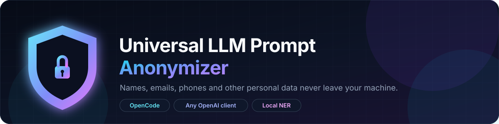
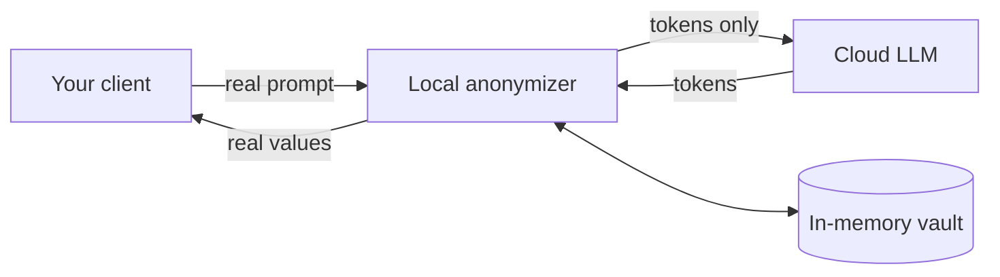

<p align="center">
  
</p>

<h1 align="center">Universal LLM Prompt Anonymizer</h1>

<p align="center">
  <b>Keep personal data out of cloud prompts.</b><br>
  A local proxy and OpenCode plugin that replaces names, emails, phones and other PII with stable tokens, then restores the real values in the response.
</p>

<p align="center">
  <a href="LICENSE"></a>
  
  
  
</p>

<p align="center">
  <a href="README.md">English</a> ·
  <a href="README.ru.md">Русский</a> ·
  <a href="INSTALL.md">Install guide</a> ·
  <a href="INSTALL.ru.md">Инструкция</a>
</p>

```
You:      My name is Sarah Connor, email sarah@example.com.
Cloud:    My name is [[PERSON_a812_1]], email [[EMAIL_a812_1]].
You see:  My name is Sarah Connor, email sarah@example.com.
```

## Quick start

### OpenCode

```bash
npm install -g github:Closegamer/universal-llm-prompt-anonymizer
prompt-anonymizer install
```

Start a new OpenCode session. The plugin starts the proxy and routes supported providers through it. Local providers such as Ollama are left alone.

### Any other client

```bash
npm install -g github:Closegamer/universal-llm-prompt-anonymizer
prompt-anonymizer
```

Keep it running, then point the client at the matching prefix. Stop it later with `prompt-anonymizer stop`.

| Provider | Base URL |
| --- | --- |
| OpenAI | `http://127.0.0.1:8787/openai/v1` |
| Anthropic | `http://127.0.0.1:8787/anthropic` |
| DeepSeek | `http://127.0.0.1:8787/deepseek/v1` |
| Google Gemini | `http://127.0.0.1:8787/gemini` |
| OpenRouter | `http://127.0.0.1:8787/openrouter/v1` |
| Groq | `http://127.0.0.1:8787/groq/openai/v1` |
| Mistral | `http://127.0.0.1:8787/mistral/v1` |
| xAI | `http://127.0.0.1:8787/xai/v1` |

Claude Code example:

```bash
ANTHROPIC_BASE_URL=http://127.0.0.1:8787/anthropic claude
```

The client keeps using its own API key. The proxy forwards authentication headers and never stores them.

Full cross-platform guide for Windows, macOS and Linux: [INSTALL.md](INSTALL.md).

## Why

Cloud LLM providers receive everything you send them: names, emails, phones, dates of birth, account numbers, file paths and tool output. This proxy keeps that data local. The model still does the work, but it sees placeholders instead of real values.

The token map lives only in the proxy's memory on your machine. It is not written to disk and is not sent to the provider.

## Features

- Local NER for names and surnames in English and Russian.
- Structured detection for emails, phones, cards, IBANs, SSNs, IP addresses, dates, nicknames, IDs and addresses.
- OS username and home path detection, including `C:\Users\name`, `/home/name` and `/Users/name`.
- Streaming-safe restoration, including tokens split across SSE events and tool call arguments.
- Works with any OpenAI-compatible or Anthropic-compatible client.
- OpenCode plugin with automatic proxy startup and provider rewiring.
- No PII at rest. The vault is memory only.
- Bilingual documentation: English and Russian.

## How it works



1. The proxy parses the outgoing JSON request and walks every string value: system prompt, message history, tool inputs, tool outputs and attached text.
2. Detectors replace PII with tokens and store the real values in an in-memory vault.
3. A system instruction tells the model that tokens are opaque and must not be changed.
4. The upstream response is restored before it reaches the client, including streamed SSE events and tool call arguments.
5. Tokens split across stream chunks are buffered and restored correctly.
6. Local providers are skipped by default.

## What gets replaced

| Category | Examples |
| --- | --- |
| Contact data | Emails, phones in international, US and Russian formats |
| Financial data | Payment cards with Luhn validation, IBANs with mod 97 validation |
| Government IDs | US SSNs, labeled passport and account numbers |
| Network data | IP addresses |
| Dates | Dates near birth labels such as `born`, `DOB`, `date of birth`, `родился`, `дата рождения` |
| Names | Names and surnames through local NER, nicknames in labeled or quoted form |
| Numbers | Long numeric identifiers, 9 or more digits |
| Addresses | English and Russian street address patterns |
| Environment | OS username and home directory paths |

Every value gets a stable token such as `[[PERSON_a812_1]]`. The same value gets the same token for the lifetime of the proxy process.

## Configuration

Copy `anonymizer.config.example.json` to `anonymizer.config.json` and edit it, or pass a path with `--config`.

```json
{
  "port": 8787,
  "routes": {
    "/corp": "https://llm.corp.example/v1"
  },
  "ner": {
    "enabled": true,
    "latinThreshold": 0.75,
    "cyrillicThreshold": 0.6
  },
  "skipUpstreamHosts": ["localhost", "127.0.0.1", "::1", "[::1]"],
  "allowUnscanned": false
}
```

A custom route is available at `http://127.0.0.1:8787/corp/...` and forwards to the configured upstream. The proxy strips the route prefix.

Useful flags:

| Flag | Meaning |
| --- | --- |
| `--port <n>` | Listen port, default `8787`. |
| `--host <addr>` | Listen address, default `127.0.0.1`. |
| `--config <file>` | Proxy config for `serve`, OpenCode config for `install`. |
| `--no-ner` | Disable the local name detector. Structured PII is still replaced. |
| `--allow-unscanned` | Forward non-JSON bodies instead of blocking them. |
| `--preload` | Load the NER models during startup. |
| `--no-log` | Disable request logging. |

The health check is at `http://127.0.0.1:8787/health`.

## Security notes

This is a best-effort privacy tool, not a guarantee. Read these limits before relying on it:

- NER can miss uncommon names, unusual nicknames and some languages. Treat the output as anonymized, not as mathematically anonymous.
- Images, audio, PDFs and base64 blobs are not scanned. Do not send screenshots or scanned documents that contain PII.
- Multipart and other non-JSON request bodies are blocked by default. `--allow-unscanned` forwards them but skips the scan.
- Local upstream hosts are skipped. A local tunnel that forwards to a cloud API would bypass anonymization unless you remove it from `skipUpstreamHosts`.
- WebSocket and NDJSON streams are not restored.
- The model can still infer information from context even when direct identifiers are replaced.
- The vault is memory only. Restarting the proxy creates new tokens and re-tokenizes the next request. This is intentional.
- The proxy does not store API keys. It forwards the headers from the client for that request.

The first use of the NER detector downloads model weights into `~/.cache/prompt-anonymizer/models`. This can take a few minutes and several hundred MB.

## Development

```bash
npm install
npm test
```

The test suite covers request anonymization, token stability, streamed and non-streamed response restoration, split tokens across SSE events, tool arguments, Anthropic streams, non-JSON blocking and the OpenCode plugin mapping.

Requirements: Node.js 22.15 or newer.

## License

MIT. See [LICENSE](LICENSE).

writtenBy('Closegamer', 2026)
