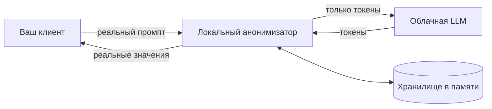

<a id="русский"></a>

<p align="center">
  
</p>

<h1 align="center">Универсальный анонимизатор промптов LLM</h1>

<p align="center">
  <b>Личные данные не попадают в облачные промпты.</b><br>
  Локальный прокси и плагин для OpenCode, которые заменяют имена, почты, телефоны и другие персональные данные стабильными токенами, а затем возвращают реальные значения в ответе.
</p>

<p align="center">
  <a href="LICENSE"></a>
  
  
  
</p>

<p align="center">
  <a href="README.md#english">English</a> ·
  <a href="#русский">Русский</a> ·
  <a href="README.md">English README</a> ·
  <a href="INSTALL.md">Install guide</a> ·
  <a href="INSTALL.ru.md">Инструкция</a>
</p>

```
Вы:       Меня зовут Иван Петров, почта ivan@example.com.
Облако:   Меня зовут [[PERSON_a812_1]], почта [[EMAIL_a812_1]].
Вы видите: Меня зовут Иван Петров, почта ivan@example.com.
```

## Быстрый старт

### Приложение для рабочего стола

Скачайте установщик со страницы [Releases](https://github.com/Closegamer/universal-llm-prompt-anonymizer/releases/latest):

| ОС | Файл |
| --- | --- |
| Windows x64 | `universal-llm-prompt-anonymizer-*-win-x64.exe` |
| macOS Apple Silicon | `universal-llm-prompt-anonymizer-*-mac-arm64.dmg` |
| Linux x64 | `.AppImage` или `.deb` |

Приложение запускает прокси, живёт в системном трее и превращает каждый детектор в галочку. Если вы хотите, чтобы даты проходили без замены, снимите галочку **Dates of birth**. Автозапуск при входе в систему включается отдельной галочкой. Настройки действуют для всех клиентов, которые используют этот прокси.

Установщики пока не подписаны. В Windows при появлении SmartScreen выберите **More info**, затем **Run anyway**. В macOS щёлкните по приложению правой кнопкой и выберите **Open**.

### OpenCode

```bash
npm install -g github:Closegamer/universal-llm-prompt-anonymizer
prompt-anonymizer install
```

Начните новую сессию OpenCode. Плагин запустит прокси и направит поддерживаемые провайдеры через него. Локальные провайдеры, например Ollama, не затрагиваются.

### Любой другой клиент

```bash
npm install -g github:Closegamer/universal-llm-prompt-anonymizer
prompt-anonymizer
```

Оставьте прокси запущенным и укажите в клиенте соответствующий адрес. Остановить прокси можно командой `prompt-anonymizer stop`.

| Провайдер | Базовый URL |
| --- | --- |
| OpenAI | `http://127.0.0.1:8787/openai/v1` |
| Anthropic | `http://127.0.0.1:8787/anthropic` |
| DeepSeek | `http://127.0.0.1:8787/deepseek/v1` |
| Google Gemini | `http://127.0.0.1:8787/gemini` |
| OpenRouter | `http://127.0.0.1:8787/openrouter/v1` |
| Groq | `http://127.0.0.1:8787/groq/openai/v1` |
| Mistral | `http://127.0.0.1:8787/mistral/v1` |
| xAI | `http://127.0.0.1:8787/xai/v1` |

Пример для Claude Code:

```bash
ANTHROPIC_BASE_URL=http://127.0.0.1:8787/anthropic claude
```

Клиент продолжает использовать свой API-ключ. Прокси передаёт заголовки авторизации дальше и не сохраняет их.

Пошаговая инструкция для Windows, macOS и Linux: [INSTALL.ru.md](INSTALL.ru.md).

## Зачем это нужно

Облачные провайдеры LLM получают всё, что вы им отправляете: имена, почты, телефоны, даты рождения, номера счетов, пути к файлам и вывод инструментов. Этот прокси оставляет эти данные локально. Модель продолжает выполнять работу, но видит токены вместо реальных значений.

Таблица токенов хранится только в оперативной памяти прокси на вашем компьютере. Она не записывается на диск и не отправляется провайдеру.

## Возможности

- Локальный NER для имён и фамилий на русском и английском.
- Структурированные детекторы: почты, телефоны, карты, IBAN, SSN, IP-адреса, даты, никнеймы, идентификаторы и адреса.
- Определение имени пользователя ОС и домашних путей: `C:\Users\name`, `/home/name`, `/Users/name`.
- Безопасное восстановление потоковых ответов, включая токены, разрезанные между SSE-событиями, и аргументы инструментов.
- Работа с любым клиентом, совместимым с OpenAI или Anthropic.
- Приложение в трее с галочками для каждой категории и автозапуском.
- Плагин OpenCode с автоматическим запуском прокси и перенаправлением провайдеров.
- Никаких персональных данных на диске. Хранилище живёт только в памяти.
- Документация на английском и русском.

## Приложение для рабочего стола

Приложение запускает тот же локальный прокси и остаётся в системном трее. Откройте настройки из трея и выберите, что именно нужно скрывать.

- **Что скрывать:** имена, никнеймы, даты рождения, имена пользователей, почты, телефоны, адреса, карты, IBAN, SSN, номера счетов и паспортов, длинные числа и IP-адреса.
- **Поведение:** автозапуск при входе, предзагрузка моделей имён, запись лога запросов, пропуск не-JSON тел без проверки.
- **Дополнительно:** порт прокси.

После сохранения прокси перезапускается. Плагин OpenCode использует уже запущенный прокси, поэтому настройки приложения действуют и в OpenCode.

Настройки хранятся в каталоге данных Electron, лог прокси лежит рядом. Кнопка **Open log** открывает его для диагностики.

## Как это работает



1. Прокси разбирает исходящий JSON-запрос и обходит все строковые значения: системный промпт, историю сообщений, входы инструментов, выводы инструментов и текст вложений.
2. Детекторы заменяют персональные данные токенами и сохраняют реальные значения в хранилище в оперативной памяти.
3. В системный промпт добавляется инструкция: токены непрозрачны и их нельзя менять.
4. Ответ провайдера восстанавливается до того, как попадёт к клиенту, включая потоковые SSE-события и аргументы вызова инструментов.
5. Токены, разрезанные между чанками потока, буферизуются и восстанавливаются корректно.
6. Локальные провайдеры по умолчанию пропускаются.

## Что заменяется

| Категория | Примеры |
| --- | --- |
| Контакты | Почты, телефоны в международном, американском и российском форматах |
| Финансы | Банковские карты с проверкой Луна, IBAN с проверкой mod 97 |
| Государственные номера | Американские SSN, размеченные номера паспортов и счетов |
| Сеть | IP-адреса |
| Даты | Даты рядом с метками рождения: `born`, `DOB`, `date of birth`, `родился`, `дата рождения` |
| Имена | Имена и фамилии через локальный NER, никнеймы в размеченной или цитируемой форме |
| Числа | Длинные числовые идентификаторы от 9 цифр |
| Адреса | Английские и русские шаблоны улиц |
| Окружение | Имя пользователя ОС и пути к домашнему каталогу |

Каждое значение получает стабильный токен, например `[[PERSON_a812_1]]`. Одно и то же значение получает один и тот же токен в течение жизни процесса прокси.

## Настройка

Скопируйте `anonymizer.config.example.json` в `anonymizer.config.json` и отредактируйте, либо передайте путь через `--config`.

```json
{
  "port": 8787,
  "routes": {
    "/corp": "https://llm.corp.example/v1"
  },
  "ner": {
    "enabled": true,
    "latinThreshold": 0.75,
    "cyrillicThreshold": 0.6
  },
  "skipUpstreamHosts": ["localhost", "127.0.0.1", "::1", "[::1]"],
  "allowUnscanned": false
}
```

Свой маршрут будет доступен по адресу `http://127.0.0.1:8787/corp/...` и будет перенаправлять запросы на указанный upstream. Префикс маршрута отбрасывается.

Полезные флаги:

| Флаг | Значение |
| --- | --- |
| `--port <n>` | Порт, по умолчанию `8787`. |
| `--host <addr>` | Адрес прослушивания, по умолчанию `127.0.0.1`. |
| `--config <file>` | Конфиг прокси для `serve`, конфиг OpenCode для `install`. |
| `--no-ner` | Отключить локальный детектор имён. Структурированные данные всё равно заменяются. |
| `--allow-unscanned` | Пропускать не-JSON тела без проверки. |
| `--preload` | Загрузить NER-модели при старте. |
| `--no-log` | Отключить логирование запросов. |

Проверка состояния: `http://127.0.0.1:8787/health`.

## Ограничения и безопасность

Это инструмент лучшего усилия, а не абсолютная гарантия. Перед использованием учтите:

- NER может пропускать редкие имена, необычные никнеймы и некоторые языки. Считайте результат анонимизированным, но не математически анонимным.
- Изображения, аудио, PDF и base64-данные не сканируются. Не отправляйте скриншоты и сканы документов с персональными данными.
- Multipart и другие не-JSON тела запросов по умолчанию блокируются. Флаг `--allow-unscanned` пропускает их, но отключает проверку.
- Локальные upstream-хосты пропускаются. Локальный туннель, который ведёт в облачный API, обойдёт анонимизацию, если не убрать его из `skipUpstreamHosts`.
- WebSocket и NDJSON-потоки не восстанавливаются.
- Модель всё ещё может делать выводы из контекста, даже когда прямые идентификаторы заменены.
- Хранилище живёт только в памяти. После перезапуска прокси создаёт новые токены и заново токенизирует следующий запрос. Это сделано намеренно.
- Прокси не хранит API-ключи. Он передаёт заголовки клиента для конкретного запроса.

При первом использовании NER-детектора модели скачиваются в `~/.cache/prompt-anonymizer/models`. Это может занять несколько минут и несколько сотен мегабайт.

## Разработка

```bash
npm install
npm test
```

Тесты покрывают анонимизацию запросов, стабильность токенов, восстановление потоковых и обычных ответов, токены, разрезанные между SSE-событиями, аргументы инструментов, потоки Anthropic, блокировку не-JSON тел, переключатели детекторов и маппинг провайдеров в плагине OpenCode.

Приложение для рабочего стола:

```bash
npm run desktop      # приложение в режиме разработки
npm run dist:win     # установщик для Windows
npm run dist:mac     # DMG для macOS, запускать на macOS
npm run dist:linux   # AppImage и deb, запускать на Linux
```

Сборка приложения копирует текущий бинарник Node.js и runtime прокси в приложение. Используйте Node.js 22.15 или новее. GitHub Actions собирает установщики для Windows, macOS Apple Silicon и Linux по каждому тегу `v*`.

Требуется Node.js 22.15 или новее.

## Лицензия

MIT. См. [LICENSE](LICENSE).

writtenBy('Closegamer', 2026)
